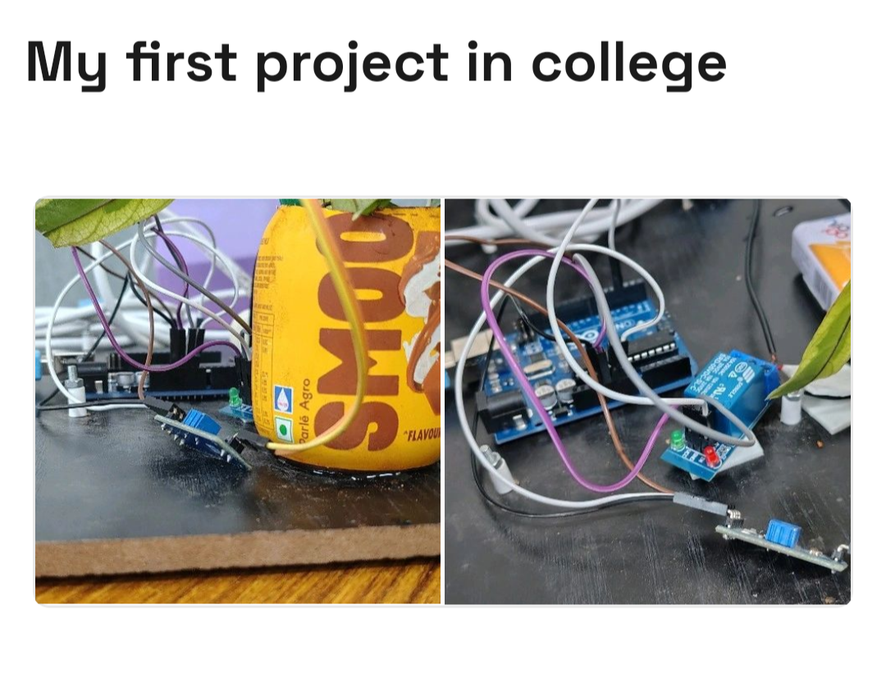

🌱 Smart Plant Irrigation System
Project Overview

The Smart Plant Irrigation System is an automated plant watering project designed to monitor soil moisture and help maintain proper water levels for plants.

Components Used:
•Arduino UNO
•Soil Moisture Sensor
•Relay Module
•Connecting Wires
•Water Pump
•Power Supply
Working Principle:
The soil moisture sensor detects the moisture level in the soil.
The Arduino receives the sensor data.
When the soil becomes dry, the system activates the water pump through the relay.
When sufficient moisture is detected, watering stops.

Applications:
•Home gardening
•Smart agriculture
•Greenhouse automation
•Water conservation
## 📸 Project Output

Conclusion
This project helps automate plant watering, saves water and reduces manual effort.
